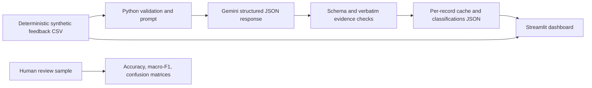

# Customer Conversation Intelligence


[](https://github.com/laura-rivera-sancho/voice-of-customer-llm-analytics/actions/workflows/ci.yml)

[Open the live dashboard](https://voice-of-customer-llm-analytics.streamlit.app/) · [Read the executive summary](docs/stakeholder_readout.md) · [Review the pilot assumptions](docs/business_case.md) · [Contact Laura](mailto:laura.riverasancho33@gmail.com)

A working reference implementation for turning high-volume customer conversations into reviewable themes, evidence-supported issue signals, and prioritized follow-up. It is designed for customer-experience, product, support, and operations teams that need to decide which recurring problems deserve investigation or action.

[](https://voice-of-customer-llm-analytics.streamlit.app/)

*Synthetic demonstration dashboard—[open the interactive version](https://voice-of-customer-llm-analytics.streamlit.app/) or [review the evidence and limitations](#demonstration-evidence).*

## The decision this supports

Which customer issues are recurring, where are they concentrated, what evidence supports each signal, and is an assisted review workflow accurate and useful enough to continue?

Model output is treated as evidence for a reviewer—not as an automated customer decision. Every classified record retains a verbatim supporting excerpt and can be corrected or escalated.

## Pilot at a glance

| Item | Typical scope |
|---|---|
| **Duration** | 3–5 weeks |
| **Inputs** | A representative, appropriately de-identified feedback sample; current taxonomy or routing rules; existing review process; subject-matter reviewers; privacy and retention constraints |
| **Week 1** | Confirm the decision, allowed uses, taxonomy, baseline, access controls, and evaluation plan |
| **Weeks 2–3** | Configure the classification workflow, validate evidence, and review category-level errors with human reviewers |
| **Weeks 4–5** | Deliver the dashboard, operating guidance, executive readout, and go / iterate / stop recommendation |
| **Buyer receives** | Decision contract, taxonomy, reproducible workflow, human-evaluation results, dashboard, review playbook, and executive recommendation |
| **Client participation** | Decision owner, data owner, and subject-matter reviewers available for taxonomy and evaluation decisions |
| **Not included** | Unreviewed automated routing, sensitive-data processing without approved controls, production authentication, enterprise integration, or long-term monitoring |

Final timing depends on data readiness, access requirements, reviewer availability, and the level of operational integration required.

## What a successful pilot demonstrates

Acceptance thresholds should be agreed after the data-readiness review. At minimum, the pilot should show:

- complete reconciliation between supplied records and reported outputs;
- traceable source evidence for every output intended to inform review;
- quality reported by important category, including ambiguous cases—not only an overall score;
- visible correction and escalation paths;
- comparison with the current process on reviewer effort or decision usefulness; and
- a clear go, iterate, or stop recommendation.

## What is available in this repository

| Evidence | Start here | What it shows |
|---|---|---|
| Live experience | [Streamlit dashboard](https://voice-of-customer-llm-analytics.streamlit.app/) | Reviewable themes, sentiment, segments, survey measures, and follow-up signals |
| Executive communication | [Stakeholder readout](docs/stakeholder_readout.md) | Findings, limitations, operational implications, and recommended next evidence |
| Pilot framing | [Business case](docs/business_case.md) | Decision context, value hypothesis, controls, and evidence required before real use |
| Evaluation | [Human-review guide and sample](data/evaluation/README.md) | Blind review design, category boundaries, disagreements, and recalculated metrics |
| Technical implementation | [Pipeline source](src) and [tests](tests) | Structured outputs, evidence checks, caching, retries, validation, and reproducibility |
| Delivery status | [Roadmap](ROADMAP.md) | Implemented capabilities and remaining production-readiness work |

## Demonstration boundary

The included organization, feedback, survey scores, action tracker, and findings are fictional or synthetic. The implementation demonstrates workflow behavior, technical controls, evaluation mechanics, and stakeholder communication; it does not claim customer impact, operational savings, or production model quality.

A real pilot would use representative, approved data and would define category-level quality thresholds, reviewer effort, escalation performance, privacy controls, and decision usefulness before launch.

## How an engagement would start

1. Identify the decision, current review process, available data, and decision owner.
2. Review a schema or de-identified sample and agree the permitted data boundary.
3. Confirm the written scope, evaluation thresholds, responsibilities, timeline, exclusions, and stop conditions.
4. Begin the pilot only after access, privacy, ownership, and review expectations are agreed.

For an initial scope discussion, [email Laura](mailto:laura.riverasancho33@gmail.com) with the decision you need to make, the available data or systems, and the target timeline.

## Architecture at a glance



The pipeline uses small Python modules and files rather than a database, agent framework, or retrieval system. The dashboard works immediately from the saved CSV and can display classifications after the optional API pipeline has run.

## Technology stack

| Layer | Technologies | Purpose |
|---|---|---|
| Application | Python 3.11+, Streamlit | Pipeline orchestration and interactive portfolio dashboard |
| LLM integration | Google Gemini via `google-genai` | Schema-guided classification of customer comments |
| Data and validation | pandas, structured JSON, deterministic CSV generation | Reproducible transformation, validation, and offline analysis |
| Visualization | Plotly | Interactive views of sentiment, themes, segments, and survey metrics |
| Configuration | python-dotenv | Local environment configuration without committing credentials |
| Quality | pytest, GitHub Actions | Offline tests and Python 3.11–3.13 continuous integration |

The design is deliberately lightweight: local files and resumable checkpoints keep the workflow inspectable, reproducible, and easy to review without requiring a database or agent framework.

## Implementation evidence

| Capability | Evidence status | What is available |
|---|---|---|
| Synthetic data and offline dashboard | Evidence available | Deterministic fictional data and an API-independent dashboard |
| Gemini classification pipeline | Evidence available | Structured output, evidence checks, resumable cache, and usage logging; 120/120 saved records validate |
| Human-review workflow | Synthetic evaluation available | All 30 sampled records have sentiment and category labels; initial blind agreement and post-review notes are documented |
| Real-data pilot readiness | Validation pending | Business case and stakeholder readout are documented; representative human evaluation and a real-process baseline are still needed before quality or value claims |
| Publication packaging | Published; CI passed | Initial `main` commit published on 2026-10-13 with the reviewed 36-file allowlist; a stakeholder readout was added in a follow-up; the Python 3.11–3.13 CI matrix passed; `.env`, per-record caches, and local API-usage logs are excluded |

## Dataset design and limitations

`data/synthetic/feedback.csv` contains 120 deterministic fictional records. The generator spans six feedback sources, three customer segments, five product areas, a date range, survey scores, and ten issue categories. The survey score rosters are seeded and reproducible, with varied CSAT 1–5 and NPS 0–10 responses; they are assigned separately from comment text and are not responses from actual customers. Scenario language repeats by design so the sample is useful for reproducible demos and tests. Records are balanced and templated; observed rates, themes, and trends must not be generalized to a real business. The output does not include generator category seeds, so they cannot be mistaken for human labels or evaluation truth.

## Model and classification

The default model is `gemini-3.1-flash-lite`, configurable with `GEMINI_MODEL`. Only the customer comment is sent to Gemini; identifiers, survey scores, and other source metadata stay local. The prompt requests JSON matching a response schema and uses a controlled category/sentiment/priority vocabulary. Root cause must be marked `Not stated` when evidence is insufficient. Supporting evidence must be a verbatim span of the original comment; invalid evidence is rejected. The classifier does not use survey scores or metadata as proof of an unstated cause.

Each successful feedback ID is cached as JSON under `data/cache/`. The pipeline validates existing output checkpoints, retries transient errors with exponential backoff and jitter, writes atomically after each record, and resumes without repeating completed classifications. It processes records serially with an 8-second minimum between API attempts by default (`GEMINI_MIN_REQUEST_INTERVAL_SECONDS`); a quota response is checkpointed and stops the run. Active Gemini quotas are model- and project-specific and should be checked in AI Studio. `data/processed/api_usage.jsonl` records request status, latency, model, and token usage without storing comment text or credentials. Set the optional input and output USD-per-million-token rates in `.env` to calculate an estimate; rates are intentionally not hard-coded and estimates do not represent provider billing.

### Completed inference snapshot — 2026-10-13

The saved batch contains **120 valid classifications for 120 input records** using `gemini-3.1-flash-lite`. The independent validator found no missing, extra, duplicate, failed, or invalid rows; the evidence audit found 120 source-grounded excerpts. The initial fast burst encountered 429 rate-limit responses, and the slower resumed run also saw transient 503 responses. Those errors were retried or resumed; no records remain failed or unclassified. Requests were kept sequential, and no billing changes or model changes were made. Google notes that active RPM/TPM/RPD limits vary by model and project and are shown in [AI Studio](https://ai.google.dev/gemini-api/docs/rate-limits).

The usage ledger contains **145 request events** for 117 record IDs: 135 responses and 10 failed attempts, with 23,668 input tokens and 14,025 output tokens recorded. Some IDs have multiple ledger events; the event file does not identify the cause of every repeat, so this count is API activity, not unique classifications. The three earlier smoke-test requests predate the ledger and are not included. No cost estimate was recorded because per-token rates were not configured.

## Demonstration evidence

| Demonstration output | Result | Interpretation |
|---|---:|---|
| Valid classifications | 120 / 120 | Every synthetic input has a schema-valid saved output |
| Evidence-grounded excerpts | 120 / 120 | Each saved classification includes supporting text found in its source comment |
| Illustrative CSAT | 3.8 / 5; 65% top-two-box | Synthetic survey output for dashboard demonstration only |
| Illustrative NPS | +20 | Synthetic result from 20 constructed responses |
| Initial blind sentiment review | 80% accuracy; 0.407 macro-F1 | 30 human-labeled cases; three of four sentiment classes represented |
| Initial blind category review | 83.3% accuracy; 0.844 macro-F1 | 30 human-labeled cases; all ten categories represented |

These results demonstrate pipeline behavior, validation, and reporting—not production model quality or real customer outcomes. The synthetic sample size, class coverage, and single-reviewer protocol are disclosed so the metrics are not overinterpreted.

## Quick start

Python 3.11+ is recommended. From the repository root:

```powershell
py -m venv .venv
.\.venv\Scripts\Activate.ps1
python -m pip install -r requirements.txt
Copy-Item .env.example .env
```

Add your own Gemini key to `.env`; never commit that file. `.env`, `.venv`, Python caches, and Streamlit secrets are ignored by Git. Generate or restore the deterministic data and refresh the review worksheet (saved labels for unchanged sample IDs are preserved):

```powershell
python -m src.generate_synthetic
python -m src.run_pipeline --make-review-sample --limit 0
```

The pipeline is pinned to `gemini-3.1-flash-lite`. Process the full input sequentially, or use `--limit N` for a bounded run. Successful outputs are checkpointed and reused on the next invocation:

```powershell
python -m src.run_pipeline
```

Optional live connection check: `python test_gemini.py` makes one Gemini API request. `python list_models.py` lists models available to the configured key. Neither command is part of the automated test suite.

Run the dashboard without model inference:

```powershell
streamlit run app/streamlit_app.py
```

The dashboard reads `data/processed/classifications.json` when it exists. It remains usable without an API key or model output.

## Analytics and business interpretation

The dashboard summarizes feedback volume, sentiment, themes, monthly volume, segment differences, product/journey issue categories, high-priority follow-ups, and an illustrative action tracker. Survey-source rows include separately generated synthetic survey ratings: CSAT uses a 1–5 scale and NPS uses a 0–10 scale. Ratings are not inferred from comments. The dashboard reports average CSAT, top-two-box (ratings 4–5), NPS, promoter/passive/detractor shares, response counts, and score distributions. NPS is calculated as promoter share (scores 9–10) minus detractor share (0–6); passives score 7–8. In the current 20-response subsets, CSAT averages **3.8/5** with a **65%** top-two-box rate; NPS is **+20** (50% promoters, 20% passives, 30% detractors). These are illustrative outputs from deliberately constructed data, not observed business results. The action tracker is a mock example, not evidence that any customer has been contacted or any issue has been resolved.

## Evaluation and reliability

The labeling guide is in `data/evaluation/README.md`; the 30-row worksheet is `data/evaluation/human_review_sample.csv`. Its sample is seeded and balanced by source and segment. Survey ratings are omitted from the blind worksheet so they cannot anchor sentiment or category labels. The separate prediction export is `data/evaluation/model_predictions.csv`. All 30 rows have human labels for both fields. Against the initial blind labels, sentiment scored **80% accuracy** and **0.407 macro-F1** (n=30; three of four classes represented), while category scored **83.3% accuracy** and **0.844 macro-F1** (n=30; all ten declared classes represented). The comparison produced 11 disagreements: six sentiment and five category. All five category disagreements were the same boundary case—human `Onboarding` versus Gemini `Documentation` for comments about a setup guide. During post-review, the reviewer judged Gemini's label more appropriate in all 11 disagreements; those judgments are recorded as notes without overwriting the original blind labels. Because that review was performed after seeing the model output and did not use an independent second reviewer, it is qualitative adjudication rather than a new accuracy estimate. `data/evaluation/codex_ai_category_review.csv` remains a separate AI-generated annotation and is not human ground truth. Run `python -m src.run_evaluation` to recalculate the initial-label comparison and refresh the disagreement file. Macro-F1 averages over the declared label set and assigns zero to classes with no true or predicted examples; report sample size and class coverage with each score.

The `supporting_evidence` field is checked against each source comment on ingestion and can be audited in saved outputs with `python -m src.qualitative_review`. Empty evidence means the output lacks a supporting excerpt; a nonmatching excerpt is flagged. Run `python -m src.validate_results` to verify complete coverage and schema-valid outputs without making API calls. Inspect false positives and false negatives by category, sentiment, segment, source, and ambiguous wording before using results operationally. Add a human escalation queue for low-confidence or contradictory cases before production use; the MVP does not ask the model to invent a numeric confidence score.

Operational reliability is kept observable through structured error messages, cached outputs, partial writes, retry behavior, configurable timeouts, and the local usage ledger. Monitor request count, token volume, configured cost estimates, cache hit rate (uncached IDs versus saved cache files), API latency, 429 errors, and output validation failures. The project does not send telemetry to an external service. Avoid placing personal, financial, health, authentication, or other sensitive data in prompts; use synthetic or properly de-identified text and follow the provider's current data handling terms.

## Tests

```powershell
python -m pytest
```

Tests cover deterministic dataset creation, evidence validation, resumable checkpoints, stratified blind sampling, separate prediction export, evaluation metrics, and usage logging. They do not call Gemini and do not assert model quality.

## Confidentiality disclaimer

This is a public portfolio project built exclusively with fictional scenarios, synthetic feedback, and illustrative outputs. It contains no client, employer, customer, or proprietary information. Names, metrics, findings, and recommended actions are demonstration artifacts and must not be interpreted as disclosures or results from a real organization. Do not add confidential, personal, regulated, or otherwise sensitive data to prompts, datasets, screenshots, issues, or commits.

## Limitations and next steps

- Synthetic, repeated feedback is not representative of real customer language or prevalence.
- Classification quality has a 30-row synthetic comparison, but the sample is still too small and templated for broad quality claims; sentiment has no human-labeled `Positive` examples, and there was no independent second reviewer.
- The model can still make plausible but incorrect categories or priorities; review evidence and errors before action.
- Root causes are hypotheses and require product or operational investigation.
- There is no multi-reviewer agreement analysis, dashboard authentication, persistent action workflow, or external monitoring.
- Before using real feedback, define retention/access controls, remove sensitive fields, review data processing requirements, and evaluate on a representative human-labeled set.

## Repository map

```text
app/streamlit_app.py            Streamlit dashboard
data/synthetic/                 Fictional input and example tracker
data/evaluation/                Blind worksheet, separate predictions, and labeling guide
docs/stakeholder_readout.md     Demonstration summary, limits, and recommended next evidence
src/classification.py           Gemini prompt, schema checks, retries, cache
src/evaluation.py               Blind sampling and human-reviewed metrics
src/generate_synthetic.py       Deterministic data generator
src/run_pipeline.py             CLI pipeline
src/run_evaluation.py           Prediction export and evaluation CLI
src/validate_results.py         Offline coverage/schema validation
src/qualitative_review.py       Evidence-grounding audit summary
tests/                          Deterministic offline tests
test_gemini.py                  Explicit, one-request Gemini smoke check
list_models.py                  Explicit Gemini model-list utility
```

## Related work

This project complements the portfolio's [data architecture framework](https://github.com/laura-rivera-sancho/data-architecture-standard-framework) and [machine learning framework](https://github.com/laura-rivera-sancho/machine-learning-standard-framework). It focuses on LLM-assisted text classification and human evaluation; it does not replace governed data-platform design or a validated production ML workflow.

## License and citation

The code is available under the [MIT License](LICENSE). Citation metadata is in [CITATION.cff](CITATION.cff). The reviewed repository is published as a public reference implementation, with local credentials and runtime artifacts excluded; see the confidentiality disclaimer and limitations above before reusing the workflow.
